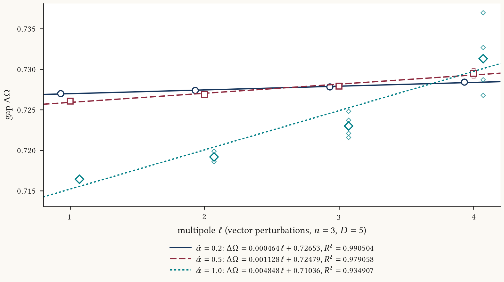

<!-- Author: Dr. Denys Dutykh (Mathematics Department, Khalifa University of Science and Technology, Abu Dhabi, UAE) -->

# GaussBonnet: scalar, vector and tensor quasinormal modes of Gauss–Bonnet black holes



The spacing ΔΩ between consecutive purely imaginary (overdamped) modes of the vector perturbations of the Gauss–Bonnet
black hole in D = 5 dimensions (n = 3), against the multipole ℓ, for three values of the coupling α̂. The small markers
are the gaps measured at several resolutions, as recorded in `regression/vectorVI.m`, the large ones their means
(shifted slightly sideways for legibility), and the lines the least-squares fits to the means, whose coefficients of
determination are those of Fig. 13 of the article. The gap grows almost linearly with ℓ, the more steeply the larger
the coupling.

GaussBonnet holds the Maple and MATLAB material of a study of the quasinormal modes of the Schwarzschild–Tangherlini
black hole corrected by a Gauss–Bonnet term, in D = 5, 6, 7, 8, 10, 11, 12 and 26 dimensions, for scalar, vector and
tensor perturbations. Three Maple worksheets carry the derivations, one per sector; three Maple procedures assemble, in
multiprecision arithmetic, the matrices of a Chebyshev collocation of the compactified radial equation; a MATLAB script
solves the resulting quadratic eigenvalue problem with the Advanpix Multiprecision Computing Toolbox at several
resolutions; and five MATLAB scripts fit straight lines to the spacing of the purely imaginary modes against the
multipole. The article finds overdamped purely imaginary modes, real parts of the higher overtones that vary
non-monotonically, a strong amplification of the dimensionless frequencies in the dimensions suggested by string
theory, an exact isospectrality between the scalar monopole and the vector dipole at vanishing coupling, proved by a
Darboux factorisation, and the first numerical confirmation of the tensor instability in six dimensions, for
GM ⩽ 158.1 α^(3/2). The method and the results are those of the article by Davide Batic and Denys Dutykh in Physical
Review D (2026), cited below.

## The problem

In D = n + 2 dimensions (n ⩾ 3) the black hole has the line element ds² = −f dt² + dr²/f + r² dΩ_n², dΩ_n² being the
metric of the unit sphere of dimension n. In the rescaled radius ρ = r/M^(1/(n−1)), with the rescaled Gauss–Bonnet
coupling α̂ of equation (5) of the article,

```text
f(ρ) = 1 + ρ²/(2α̂) [ 1 − √(1 + 8α̂/ρ^(n+1)) ],          ρ_h^(n−1) + α̂ ρ_h^(n−3) = 2,
```

the second equation giving the event horizon ρ_h. For n = 3 a horizon exists for 0 ⩽ α̂ < 2 only; for n ⩾ 4 there is
always one, which shrinks as α̂ grows. With the time dependence e^(−iωt), each perturbation obeys an equation of the
form f d/dρ( f dR/dρ ) + [Ω² − U(ρ)] R = 0, with the dimensionless frequency Ω = ω M^(1/(n−1)) (Im Ω < 0 for a damped
mode) and a potential U of its own sector: the scalar one is given by equation (10) of the article, the vector and
tensor ones, which involve further functions of the background, in sections V and VII. The angular momentum enters
through

```text
λ = ℓ(ℓ + n − 1)     scalar sector (s = 0, ℓ ⩾ 0) and tensor sector (s = 2, ℓ ⩾ 2),
λ = (ℓ − 1)(ℓ + n)   vector sector (s = 1, ℓ ⩾ 1).
```

The map ρ = 2ρ_h/(1 − y) sends the event horizon to y = −1 and infinity to y = +1. Once the ingoing behaviour at the
horizon and the outgoing one at infinity have been factored out, the regular part of the solution is expanded in N
Chebyshev polynomials and the equation is collocated at the N roots y_i = cos((2i − 1)π/(2N)), which gives

```text
( M0 + i Ω M1 + Ω² M2 ) a = 0
```

with three real N × N matrices; Maple exports `M1` without the factor i, which the driver applies when it solves the
problem as `polyeig(M0, mp('1i')*M1, M2)`.

In the code, `n` is the dimension of the sphere of the line element, so that D = n + 2 and the mass term of f carries
the exponent n − 1 = D − 3; `ah` is the rescaled coupling α̂ and `rhoh` the horizon ρ_h. The comments of the three
procedures call `n` the number of compactified dimensions and `ah` the physical string coupling parameter, and some
figure captions of the article also call n the number of compactified dimensions; the definition that the code
follows is D = n + 2, that of section II of the article.

## Quick start

The procedures write their matrices into the folder `data/` of the path they are given, which must exist. In a
terminal:

```bash
git clone https://github.com/dutykh/GaussBonnet.git
cd GaussBonnet
mkdir -p matlab/data
```

In Maple, started in the folder of the repository, read the procedure of the sector and call it once per resolution;
here the scalar sector with ℓ = 0 in D = 5 (n = 3) at α̂ = 0.1, the matrices going to `matlab/data/`:

```maple
read "matlab/matrixassembler-scalar.mpl":
MatrixAssembler(150, 100, 0, 3, 0.1, "/absolute/path/to/GaussBonnet/matlab"):
MatrixAssembler(150, 120, 0, 3, 0.1, "/absolute/path/to/GaussBonnet/matlab"):
MatrixAssembler(150, 140, 0, 3, 0.1, "/absolute/path/to/GaussBonnet/matlab"):
```

The arguments are the number of digits `d`, the number of Chebyshev modes `N` (the size of the matrices), the
multipole `L` (that is ℓ), `n`, `ah` and the path `p` of the folder that holds `data/`. The procedure finds and prints
the event horizon (by `fsolve` in 0 ⩽ ρ_h ⩽ 3) and writes `data/M0_N.mat`, `data/M1_N.mat` and `data/M2_N.mat` in the
ASCII format of MATLAB. The procedures `matrixassembler-vector.mpl` and `matrixassembler-tensor.mpl` are called in the
same way; the vector one evaluates the Chebyshev polynomials and their derivatives at the collocation points once, in
matrices, and keeps the coefficient functions with `option remember`, which makes it noticeably faster at large N.

Then, in MATLAB, set the variable `advanpixPath` at the top of `matlab/chaseQNMs.m` to the folder of the Advanpix
toolbox, set the list of resolutions `list` to the assembled ones (`[100, 120, 140]` as distributed), and run, from the
folder `matlab/`:

```matlab
chaseQNMs
```

For each resolution n the script sets the precision to n digits (`mp.Digits(n)`), reads the three matrices with
`mp.read`, skipping a resolution whose files are missing, solves the eigenvalue problem, saves the spectra of all the
resolutions with `list` to `qnms.mat`, and draws them in the plane of Re ω and Im ω, one colour per resolution. The
quasinormal frequencies are the eigenvalues that stay in place from one resolution to the next; the others are
artefacts of the truncation. The number of digits `d` given to Maple must be at least the largest resolution, since the
script computes with n digits. The article overlaps N = 250, 280 and 300 and computes with 300 digits.

## The regressions of the spectral gap

The folder `regression/` studies how the spacing ΔΩ of the purely imaginary modes varies with the multipole, for
several values of the coupling. Each script records the gaps measured at successive resolutions, averages them for each
pair of α̂ and ℓ (with their standard deviation), fits a straight line to the means by least squares, prints the slope,
the intercept and the coefficient of determination R², and saves the figure in `shots/` (PNG and PDF) and the table of
gaps in `data/` (a `.mat` file holding a MATLAB `table`), both folders being created if absent. The figures and the
coefficients are those of the article:

| Script | Sector | Sphere | Couplings α̂ | Output | Article |
|---|---|---|---|---|---|
| `scalarL.m` | scalar | n = 3 (D = 5) | 0.2, 0.5 | `scalar-linreg-01` | Fig. 5 |
| `vectorVI.m` | vector | n = 3 (D = 5) | 0.2, 0.5, 1.0 | `vector-linreg-01` | Fig. 13 |
| `vectorX.m` | vector | n = 4 (D = 6) | 0.1, 0.2, 0.5 | `vector-linreg-02` | Fig. 15 |
| `vectorXV.m` | vector | n = 5 (D = 7) | 0.1, 0.2 | `vector-linreg-03` | Fig. 17 |
| `tensorL.m` | tensor | n = 4 (D = 6) | 0.1, 0.2, 0.5 | `tensor-linreg-01` | Fig. 26 |

The helper `addSpectralGapData.m` appends one row (α̂, ℓ and the list of measured gaps) to the table. The scripts are
run from the folder `regression/`, in MATLAB:

```matlab
cd regression
vectorVI      % or scalarL, vectorX, vectorXV, tensorL
```

They need the class `table` of MATLAB, which GNU Octave 11.1 does not have: there they stop at its first call.

## Contents

| Path | Content |
|---|---|
| `maple/` | the three Maple 2024 worksheets of the derivations, scalar, tensor and vector, for the non-extremal black hole: horizon, coupling, metric function and its derivatives, effective potential and coefficients of the equation (with the parameters `n`, `alphah` and `L` at their top) |
| `matlab/matrixassembler-*.mpl` | the three Maple procedures `MatrixAssembler(d, N, L, n, ah, p)`, scalar, vector and tensor |
| `matlab/chaseQNMs.m` | the MATLAB driver |
| `regression/` | the five regression scripts, their helper, the stored tables (`data/`) and figures (`shots/`) |
| `docs/figures/` | the script `plot_readme_figure.py` that draws the figure of this page from the gaps of `regression/vectorVI.m`, with the style file beside it |

## Requirements

Maple 2024 or later, in which the worksheets are saved. MATLAB with the Advanpix Multiprecision Computing Toolbox (a
commercial toolbox) for `chaseQNMs.m`: the pencils are severely ill-conditioned at high resolution and double precision
does not suffice. The regression scripts need MATLAB only. The figure of this page needs Python 3 with NumPy and
Matplotlib, and is redrawn from `docs/figures/` by `python3 plot_readme_figure.py`.

## How to cite

If you use this code, please cite the article:

D. Batic and D. Dutykh, Quasinormal modes of Gauss–Bonnet black holes via the spectral method: scalar, vector, and
tensor perturbations, Physical Review D 114, 044015 (2026).

https://doi.org/10.1103/91q6-r3jd

```bibtex
@article{Batic2026e,
  author = {Batic, Davide and Dutykh, Denys},
  title = {Quasinormal Modes of {{Gauss-Bonnet}} Black Holes via the Spectral Method: {{Scalar}}, Vector, and Tensor Perturbations},
  journal = {Physical Review D},
  year = 2026,
  month = aug,
  volume = {114},
  number = {4},
  pages = {044015},
  doi = {10.1103/91q6-r3jd},
  eprint = {2608.06083},
  archiveprefix = {arXiv}
}
```

The button "Cite this repository" in the right-hand column of this page gives the same reference, read from
`CITATION.cff`. A free copy of the article is on arXiv:

https://arxiv.org/abs/2608.06083

## Licence

GNU General Public License, version 3 (see `LICENSE`).

## Authors

Davide Batic and Denys Dutykh (Mathematics Department, Khalifa University of Science and Technology, Abu Dhabi). The
article is listed, with the other studies of quasinormal modes of the same group, in the
[Quasi-Normal Modes Hall of Fame](https://qnms.denys-dutykh.com/).

https://www.denys-dutykh.com/
